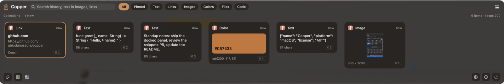
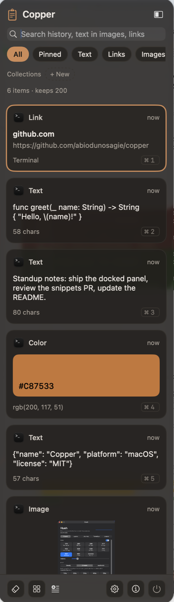
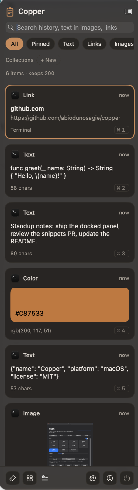
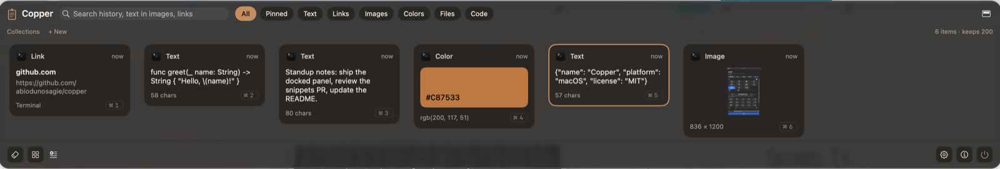

# Copper

A clipboard manager for macOS. Copper keeps everything you copy: text, links, images, colors, code and files. It shows them as cards in a panel you can dock to any edge of the screen. It also knows when you copied an API key, and treats it differently.



Copper is built on [Maccy](https://github.com/p0deje/Maccy) by Alex Rodionov (MIT). Maccy provides the clipboard history, search and the classic popup. Copper adds the docked card panel, secret handling, transforms, collections, snippets, backups, sharing between Macs and the rest of the features below. Maccy's license is kept in [LICENSE](LICENSE).

## Dock it where you like

The panel docks to the right, left, top or bottom of the screen and follows the mouse to whichever display you are using. On the sides the cards stack in a column. On the top and bottom they run in a row. Switch edges from the button in the panel header.

<p>
  
  &nbsp;
  
</p>



The classic Maccy popup (at the cursor, the menu bar icon, the window or the screen center) is still there in Settings > Appearance.

## Features

**History**
- Cards for every kind of copy: link previews with the page title and thumbnail, color swatches, code, rich text, images, GIFs that animate, the first page of a PDF, file lists, and a big emoji when you copy one.
- Filters for Pinned, Text, Links, Images, Colors, Files and Code.
- Search finds text inside images too. Date words work in search: `yesterday invoice` finds invoices copied yesterday. Today, yesterday, this or last week and this or last month are supported.
- Unlimited history if you want it, or keep items for 1, 7, 30, 90 or 365 days. Pinned items are always kept.
- Drag a card out of the panel into any app. Option-Space opens it in Quick Look.
- A main window with a sidebar (all, pinned, types, source apps, collections) and a grid of cards, from the grid icon in the panel footer.

**Organize and reuse**
- Collections: put items into named collections and filter by them from the panel header.
- Snippets: saved text with placeholders for `{date}`, `{time}`, `{datetime}`, `{clipboard}` and `{uuid}`, filled in when you paste.
- Edit an item before pasting it. The edited text is copied as a new item and the original stays as it was.
- Command-click several cards and merge them, joined with new lines, commas or spaces.
- Paste as plain text in apps you choose.

**82 text transforms.** Right-click an item, then Transform. They are grouped as case, whitespace, lines, encode and decode, JSON, hash, text, developer and Flutter. The Flutter group turns JSON into a typed Dart model class and converts between hex and Flutter `Color`. The result is copied as a new item.

**Secrets**
- Copper recognizes 16 kinds of credentials when they land on the clipboard: private keys, AWS, GitHub, GitLab, Anthropic, OpenAI, Stripe and Paystack, Google, Slack, SendGrid, npm, Vercel, Supabase, Resend and Hugging Face keys, and JSON Web Tokens.
- By default a secret is kept so you can copy it again, then deleted 60 minutes after the last copy. You can also choose to never save secrets, or to keep them.
- A copied secret is wiped from the system clipboard after a minute (never, 30 seconds, 1, 2 or 5 minutes) unless you have copied something else since.
- Secrets never appear in notifications, are never written to disk for Quick Look, are never fetched for a link preview, and are never sent to another Mac. Secrets set to expire are left out of backups.
- Copies from password managers (1Password, Bitwarden, KeePassXC, LastPass, Dashlane, Apple Passwords, Keychain Access, Proton Pass, Enpass, NordPass and Keeper) are not recorded.
- Files copied from folders you choose are not recorded.

**Backups.** Export your history to a password-protected file and import it on another Mac. The file is encrypted with AES-GCM, using a key derived from your password with PBKDF2-HMAC-SHA256 at 600,000 rounds.

**Other Macs.** Send an item to Copper on another Mac on your network: right-click, then Send to. It is off by default. Once you turn it on with a pairing code, the Macs find each other over Bonjour and talk over TLS with a key derived from that code, so a Mac with a different code cannot connect. Received items go into history, never straight onto the clipboard.

**Sound.** A soft sound when something is copied, which you can turn off.

## Install

Download `Copper.dmg` from the [latest release](https://github.com/abiodunosagie/copper/releases/latest), open it and drag Copper into Applications.

Copper is not notarized by Apple yet, so the first time you open it macOS will say it cannot check the app. To open it anyway:

1. Right-click Copper in Applications and choose Open, then Open again. On recent versions of macOS, go to System Settings > Privacy & Security instead and click Open Anyway next to the Copper message.
2. Or run this once in Terminal:

```bash
xattr -dr com.apple.quarantine /Applications/Copper.app
```

If you would rather not do either, build it from source (below).

Copper asks for Accessibility access the first time it pastes for you. That permission is what lets it paste into the app in front.

Press <kbd>Shift</kbd><kbd>Command</kbd><kbd>C</kbd> to open the panel, or click the menu bar icon.

## Requirements

- macOS 14 or later
- Xcode 16 or later to build from source

## Build from source

```bash
git clone https://github.com/abiodunosagie/copper.git
cd copper
./scripts/build.sh
```

The script builds a Release copy, installs it to `/Applications/Copper.app` and opens it. It signs with automatic signing, so open `Maccy.xcodeproj` once and pick your own team under Signing & Capabilities first.

The folders, scheme and Swift module are still called `Maccy` on purpose, so fixes from Maccy keep merging cleanly. The app itself is `Copper`, with the bundle id `com.abiodunosagie.Copper`.

## Tests

```bash
./scripts/test.sh
```

The tests write to the real system clipboard, so the script quits Copper before it runs them. Otherwise Copper would record the test data in your history.

## Project layout

```
Maccy/
  Clipboard.swift            watches the clipboard, secret wipe, password manager pause
  SecretDetector.swift       the credential patterns and the expiry rules
  TextTransform*.swift       the transforms, one file per group
  Snippet.swift              snippets and placeholders
  Backup.swift               encrypted export and import
  PeerShareService.swift     sending items to other Macs
  PeerPairing.swift          pairing code, TLS pre-shared key, Bonjour
  LinkPreviewLoader.swift    link titles and thumbnails, skips private and credentialed URLs
  DateQuery.swift            date words in search
  PopupPosition.swift        the four docked edges and the classic positions
  FloatingPanel.swift        the panel window
  Views/                     cards, panel header and footer, main window
  Settings/                  settings panes
MaccyTests/                  unit tests
scripts/build.sh             Release build, install and launch
scripts/test.sh              quits Copper, then runs the tests
```

## Privacy

Your history lives in `~/Library/Containers/com.abiodunosagie.Copper/` on your Mac. Copper only uses the network to fetch link previews (you can turn that off), and to send items to your other Macs when you turn sharing on. It collects no analytics.

## License

MIT. Copper is a derivative of Maccy, and both copyright notices are in [LICENSE](LICENSE).

## Author

Abiodun Osagie, mobile, front-end and full-stack developer.
[Portfolio](https://smithportfolio.smitho.workers.dev) · [GitHub](https://github.com/abiodunosagie) · [LinkedIn](https://linkedin.com/in/osagieabiodun)
